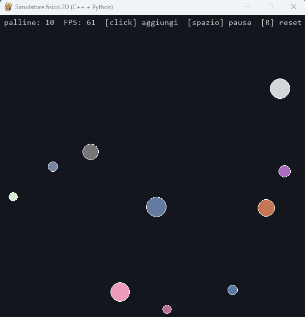

# Simulatore fisico 2D (C++ + Python)

Motore fisico 2D scritto in **C++** ed esposto a **Python** con **pybind11**;
l'interfaccia grafica è in **pygame**. Palline che cadono, rimbalzano sulle pareti e si urtano tra loro.



## Cosa fa

- Integrazione del moto con **Eulero semi-implicito** (prima la velocità, poi la posizione)
- **Collisioni cerchio-cerchio** con impulso lungo la normale e coefficiente di restituzione
- Correzione delle compenetrazioni pesata sulle masse
- Rimbalzi sulle quattro pareti
- Validazione dei dati: un corpo con massa o raggio non positivi lancia `ValueError` in Python
- Il calcolo pesante è in C++, il disegno in Python (sub-stepping: 4 passi di fisica per frame)

## Struttura

| Cartella / file | Contenuto |
|---|---|
| `Simulatore_Fisica_2D/Vec2, Body, World` | Il motore C++ (vettori 2D, corpi, mondo e collisioni) |
| `Simulatore_Fisica_2D/bindings.cpp` | Il ponte pybind11 verso Python |
| `Simulatore_Fisica_2D/main.cpp` | Test C++ da riga di comando (stress test con 20 palline) |
| `python/main.py` | Interfaccia pygame |

## Come compilare ed eseguire

Requisiti: Windows, Visual Studio con il componente *Strumenti C++ CMake per Windows*, Python 3.14 a 64 bit.

```
py -3.14 -m pip install pybind11 pygame-ce
```

1. Apri la cartella del progetto in Visual Studio (**File → Apri → Cartella**).
2. Seleziona la configurazione **x64-release** e fai **Compila → Compila tutto**.
3. Avvia la simulazione:
```
   py -3.14 python/main.py
```

Comandi: click sinistro = aggiungi una pallina, `Spazio` = pausa, `R` = reset, `Esc` = esci.

## Limiti noti

- L'integratore di Eulero fa derivare un po' l'energia nel tempo (si riduce con un passo più piccolo).
- Le collisioni sono un confronto tra tutte le coppie, quindi il costo è O(n²): fluido fino a circa 100 palline.
- Nessuna protezione dal *tunneling*: a velocità molto alte una pallina può attraversare una parete o un'altra pallina.
- Le pile molto dense di palline possono compenetrarsi leggermente.

## Cosa ho imparato

C++ (header/sorgenti, riferimenti, operator overloading, eccezioni), fisica delle collisioni
(impulso, restituzione), collegamento C++ ↔ Python con CMake e pybind11 (incluso il problema
delle copie contro i riferimenti negli elenchi).